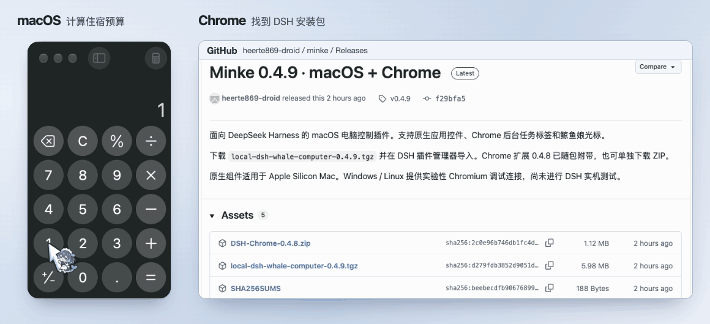
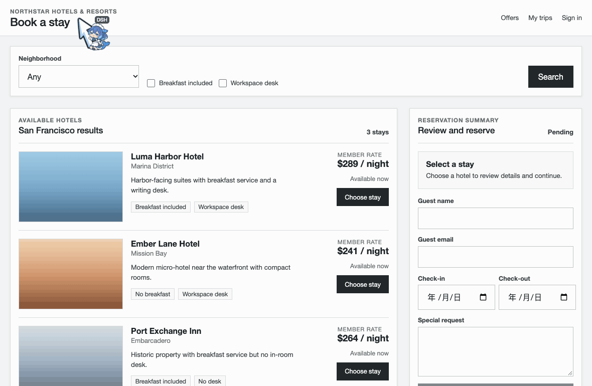
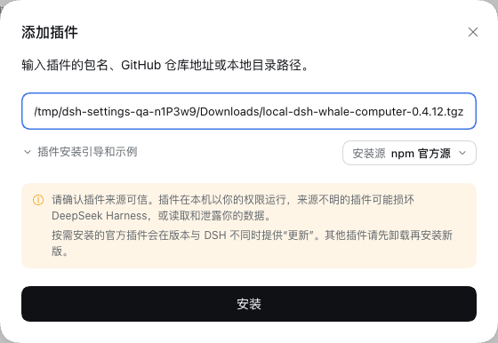

<h1 align="center">Minke</h1>

让 DeepSeek Harness 操作 Mac 应用和 Chrome 网页。鲸鱼娘光标指向 AI 当前操作的控件。

<a href="https://github.com/heerte869-droid/minke/releases/download/v0.4.12/local-dsh-whale-computer-0.4.12.tgz"><strong>下载 DSH 插件 ↓</strong></a>　·　<a href="#install">安装方法</a>　·　<a href="https://github.com/heerte869-droid/minke/releases">所有版本</a>

看 Chrome 表单实操：把 3 个住宿选项筛到 1 个

## 装进 DSH

1. 下载 **[DSH 安装包（.tgz）](https://github.com/heerte869-droid/minke/releases/download/v0.4.12/local-dsh-whale-computer-0.4.12.tgz)**，无需解压。
2. 打开 DSH 左侧的 **插件 → 添加插件**，粘贴该文件的完整路径，点 **安装**。访达中选中文件后按 `⌥⌘C` 可复制路径。
3. 需要操作 Chrome 时，在 DSH 的 **设置 → 电脑控制 → 安装 Chrome 扩展** 中取得扩展目录。到 Chrome 扩展管理页开启开发者模式，点 **加载已解压的扩展程序**，选择该目录。

查看 DSH 安装窗口

适用 Apple Silicon Mac、macOS 14+、DSH 0.2.2-rc.3 / rc.5；Chrome 扩展需要 Chrome 118+。Windows / Linux 已通过 Chromium 适配自动化检查，尚未在这两个系统的 DSH 桌面端实测。

[浏览器连接与权限](docs/EXTENSION.zh.md) · [工具接口](docs/API.md) · [从源码构建](docs/TESTING.md#build) · [MIT 许可](LICENSE) · [素材与第三方说明](THIRD_PARTY_NOTICES.md)
